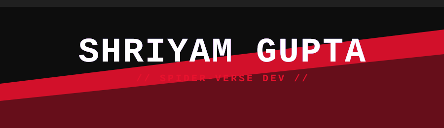
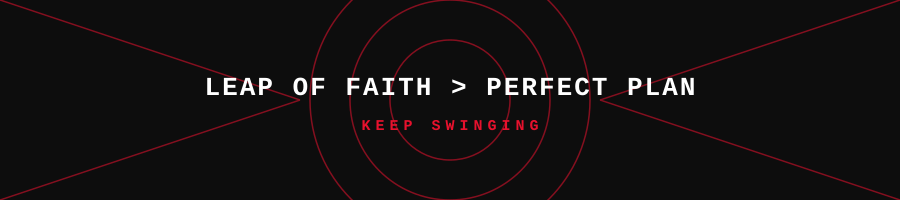

  

---

## 🌌 Earth-616? Nah, Earth-Shriyam

> **First-year BTech CSE (AI/ML)** @ Bosscoder School of Technology
---

## 🕸️ Active Missions

| 🎯 Mission | Details |
|:--|:--|
| 🎙️ **VoiceOS** | Python voice layer for file operations (Nullstack) |
| 🏔️ **ShailDrishti** | AI landslide early-warning + safety platform for NER (SIH 2026) |
| 🧟 **Fork of the Dead** | Horror web game, GitHub issues become monsters (Hacktoberfest BLR) |
| 📚 **Training Arc** | Java, DSA, Competitive Programming |

---

## 🛹 Gadgets (Tech Stack)

---

## 📈 Multiverse Stats

 

---

## 🐍 Contribution Web

---

## 📡 Connect Across Universes

 

*"You're not the only one. Anyone can wear the mask."* 🕷️

